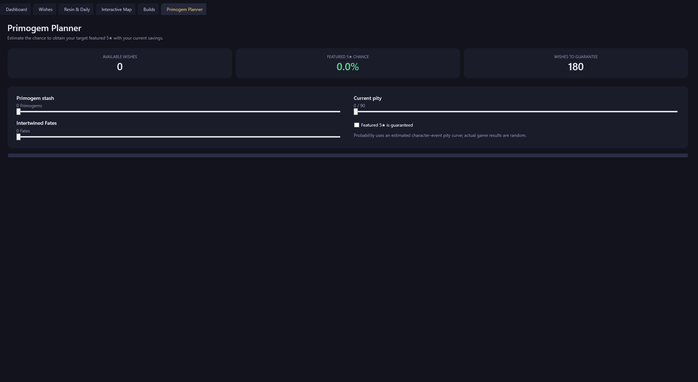

# Genshin Wish Tracker

## Your wishes, pity, and daily progress at a glance

Keep your Genshin Impact wish history close while you play. Genshin Wish Tracker is a free, community-made Windows companion with a live wish dashboard, pity counters, an interactive map, embedded character showcases, GitHub Discussions, and a resin and daily-commission view.

**Want to try it?** Download **`GenshinWishTrackerSetup.exe`** from the [latest GitHub Release](https://github.com/greyfoxdevelopment/GenshinWishTracker/releases/latest). Run the installer, accept the license, choose an install location, and it downloads and verifies the latest app for you. An internet connection is required during installation.

> The installer is published with tagged releases. If there is no installer asset on the latest release yet, check back after the next project release.

> ⚠️ **Note on Windows Warnings:** Windows SmartScreen may show a warning for the unsigned installer. Click **"More info"** and **"Run anyway"**, or verify safety via the VirusTotal report below:

> 🛡️ **[View the latest VirusTotal Scan Report - V1.0.1 ](https://www.virustotal.com/gui/file/d84c52f349f17a646646a9be2b5abf49b1c817d29417c4160960648be49cdaec?nocache=1)**
        **Virus total Link will be updated with each new Release**

## Screenshots

   &nbsp;&nbsp;&nbsp;&nbsp;
  

   &nbsp;&nbsp;&nbsp;&nbsp;
  

## Made for your play session

* **Track your wishes and pity.** View Character Event, Weapon Event, and Standard banner counts, including 4-star and 5-star pity. Sync your history by reading the game's local web cache to retrieve available history from HoYoverse safely.

* **Plan your next character.** Explore an estimated featured-character probability based on primogems, fates, pity, and guarantee state. View a public character showcase by UID in the embedded Enka.Network page, including its character and artifact details.

* **Keep useful tools together.** View real-time player data in your companion dashboard, tracking your current Resin, commissions, Realm Currency, and expedition progress.

* **Join the community.** Browse the project's GitHub Discussions in the dashboard and open them in your browser if needed.

* **Integrated layout features.** Open GitHub Discussions, HoYoLAB's interactive map, and public Enka.Network showcases inside the app. Resize or move the window to fit your play setup, or keep it pinned on top.

## A privacy-conscious companion

The app reads the game's local cache files; it does not interact with the game process. Wish history and settings are stored locally under `%LOCALAPPDATA%\GenshinWishTracker`. The wish link is held in memory during syncing and is not written to the history, settings, or logs. Network requests are made to the services needed for the feature you use, including HoYoverse, HoYoLAB, Enka.Network for public showcase pages, and GitHub for releases and updates.

This is an unofficial community project, not affiliated with or endorsed by HoYoverse. Genshin Impact is a trademark of HoYoverse (COGNOSPHERE).

## Need help?

See [`instructions.txt`](instructions.txt) for installation, first-time setup, feature guides, troubleshooting, and developer/release instructions.

## For developers

The app is a Windows x64 WPF application built with .NET 8. Open `src\GenshinWishTracker.csproj` in Visual Studio or build it with the .NET 8 SDK. See `instructions.txt` for build and release steps.

Released under the [MIT License](LICENSE).
